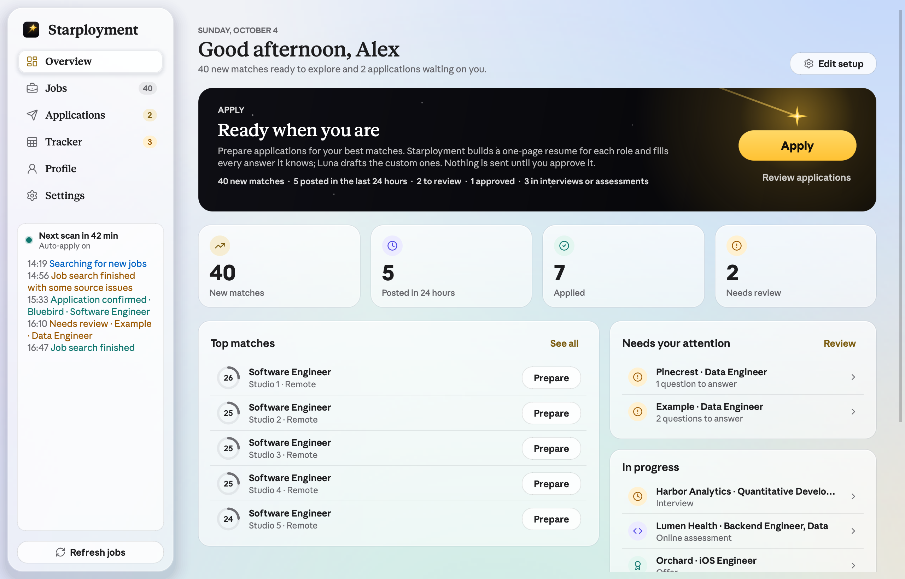

# Starployment

Starployment (formerly JobHub; this repository was renamed from `JobHub`) is a private, local job-search workspace. It reads your resume, keeps a large
resume library and the answers employers ask for, finds and ranks roles from public job boards, prepares a
one-page resume and a filled application for each role, and sends only the applications you approve. A Tracker
spreadsheet follows every application, and an optional inbox connection moves them to Assessment, Interview,
Offer, or Rejected as replies arrive.

The native PySide6 desktop app is the primary interface and runs on macOS, Windows, and Linux. The older
FastAPI web UI remains for compatibility. Python package and command names still use `jobhub`.



Contributors and coding agents should start with [AGENTS.md](AGENTS.md). Roadmap: [docs/ROADMAP.md](docs/ROADMAP.md).

## Start

On macOS, open `/Applications/Starployment.app` (or double-click `Launch Starployment.command` in a checkout).
`Set up Starployment.command` opens the setup wizard. From a terminal:

```sh
git clone https://github.com/matthewstar05/starployment.git
cd starployment
uv sync --frozen
uv run playwright install chromium
./run_desktop.sh          # Windows: run_desktop.bat   Linux: ./run_desktop.sh
```

## Setup, without syntax

The wizard has five steps: **Resume → About you → What to look for → Answers → Connect**.

- Drop your resume PDF. Your jobs, projects, education, and skills become your **resume builder**.
- Job titles, places, and excluded words are chips: type and press Return. Other facts (home city, languages,
  notice period…) are label/value rows with suggested labels. Nothing uses `label | value` lines anymore.
- Eligibility answers are **Yes / No / Not set** choices. Anything left unset pauses an application and asks you.
- **Connect** (optional) links Luna and your inbox. Everything can be changed later in Profile and Settings.

## Applying: prepare, review, send

1. **Overview → Apply.** Choose how many to prepare (top 100 matches by default), how recently the roles were
   **posted** (any time, 24 hours, 3 days, or a week), the **order** (best match or newest first), a minimum match
   score, and one per company. For example: the top 50 roles posted in the last 24 hours, so you apply early.
   Starployment reads each employer's published form (Greenhouse, Lever, and Ashby), fills every answer your saved
   facts support, asks Luna to draft the custom questions, and builds the resume for the role. Nothing is sent.
2. **Applications** lists the prepared applications with filters (Starred, To review, Approved, Sent, Issues),
   search, and a **Sort** menu (recent activity, newest posted, best match, company, status). Each shows its
   questions (what still needs you first), where every answer came from (profile, saved answer, Luna draft, AI
   Autofill, or needs you), the resume, and the posting. "Select all that apply" questions are checklists. Edit
   anything, then **Approve & send**, or use **Send ready** for every application that is ready.
   - **Right-click** an application to star it, **Mark as sent…** (you applied on the employer's site yourself; it
     moves to the Tracker as Applied and is never sent again), or remove it. Removing a prepared application returns
     its job to Jobs (or skips it); removing an attempt hides it from the list while its history and Tracker row stay.
   - **Stars and priority companies.** Star any application you want to refine. Applications to your priority
     companies (FAANG+ by default: Google, Meta, Apple, Amazon, Netflix, Microsoft, Nvidia, OpenAI, Anthropic, top
     trading firms, and more; edit the list in **Settings → Priority companies**) are starred automatically. Starred
     applications are prepared like any other, but **Send ready** and automatic runs skip them: each one waits for
     its own Approve & send.
   - **Answer once, fill everywhere:** a general answer you give in one application (offers, prior interviews,
     languages, office attendance) fills the same question in your other prepared applications and joins your
     question bank. Legal acknowledgements stay per application. Saving Profile → Answers refills every draft.
   - **AI Autofill** fills every open question in one application with realistic answers from your profile and
     settings (for example, years of experience), written the way you would: short where the question is short,
     with the two or three skills the role uses rather than your whole skill list. Where your facts are silent it makes a reasonable assumption and
     labels it "Assumption:", so you can check before sending. Demographic questions are declined, never guessed,
     and autofilled answers are never copied to other applications.
3. Sending runs the browser engine against the live form, quietly in the background: no window opens and
   nothing takes focus (Settings → Automation → **Show the browser while sending** to watch). Several
   applications go out side by side (**Send applications N at once**, 4 by default), one per employer at a time,
   so a batch of 50–100 finishes in a fraction of the time. Each counts as applied only after a new employer
   confirmation and a durable local record. New questions found on the live form come back to Applications.
4. **Reset unfinished…** removes every prepared application that was not sent (and, optionally, practice runs and
   attempts that stopped before Submit) so you can prepare again after changing your resume or answers. Anything
   that was submitted is always kept.

Practice mode (Settings → Automation) fills forms without clicking Submit, even when you send. Automatic
applications without review remain available and off by default; they never apply to a priority company or a
starred role.

## Finding jobs

**Jobs** ranks every role against your profile. The **Posted** column shows when each role was published (with the
time when the source gives one, and how long ago; roles from the last 24 hours show their age in green). Use the
**Posted** menu to keep roles from the last 24 hours, 3 days, week, or 30 days, and sort by clicking a column
header or with the **Sort** menu (best match, newest posted, recently found, salary, company, title, status).
Sorting and the date window apply to every page. Overview's **Posted in 24 hours** tile opens the newest roles.

Scans read the bundled Greenhouse, Lever, and Ashby boards (about 200 companies), Simplify's new-grad list,
RemoteOK, and JobSpy searches on Indeed, LinkedIn, and Google Jobs. With **Discover more boards** on (Settings →
Company job boards), every posting found on a Greenhouse, Lever, or Ashby board also adds that company's whole board
to later scans, read about 120 boards per provider at a time. Greenhouse boards are read from their compact listing,
and full descriptions are fetched only for new matches.

Starployment reads each employer's form ahead, so the questions you answer in review are the ones the live
form asks. A required upload it cannot attach (a transcript, say) is flagged in review before sending; apply on
the employer's site and use **Mark as sent**. A required cover letter is written from your resume. Developers can
check the whole send path against real public forms with `scripts/form_audit.py` (practice mode, fictional
candidate, nothing uploaded or submitted).

## Resume builder and resume files

**Profile → Resume builder** holds any number of roles, projects, schools, skills, and awards, each with
highlights you write once. For every role, Starployment ranks the library against the posting and drops the least
relevant bullets and entries until the PDF fits exactly one page. It never rewrites your wording. Pin an entry to
always include it, hide one to keep it out, and **Preview for a role** to see the PDF for a real match. Luna can
optionally choose the entries (by reference only; her selection is validated).

**Profile → Resume files** keeps your own PDFs by role type (software engineering, data science, machine learning,
fintech and quant, product, general). Choose **Matched file** to send the file whose role type fits each job,
**Generated** for the one-page builder resume, or **Main resume**.

## Luna and connections

Luna drafts answers to employers' open questions (why this company, describe a project, experience with X) from
your saved facts only, and can pick resume content. She never answers questions only you can: work authorization,
sponsorship, salary, start date, relocation, demographics, legal attestations, or contact details. Every draft is
marked and waits for your approval; short, general answers you approve can join your question bank.

**Settings → Connections** links Luna to an account you already have, with one button at each step:

| Choice | What you need |
| --- | --- |
| Claude | A Claude Pro or Max plan and the Claude Code app. Press **Get the app**, then **Sign in**, then **Test**. |
| ChatGPT | A ChatGPT Plus or Pro plan and the Codex app, with the same three steps. |
| Anthropic or OpenAI API key | Paste the key; it is stored in your system credential vault. |

CLI agents run with tools, plugins, MCP servers, and web access disabled, in an empty scratch folder, so posting
text cannot make them act on your computer.

**Email**: choose Gmail, Outlook, iCloud, Yahoo, or another IMAP provider, enter your address and an app password
(the button links to your provider's page), and press **Test**. With **Track replies** on, Starployment reads recent
mail read-only after each scan, recognizes assessments, interview invitations, offers, rejections, and
confirmations, and advances the matching application. It stores only each message's sender, subject, and date, and
a stage only moves forward unless you change it yourself. The same mailbox can finish Greenhouse email codes.

## Tracker

**Tracker** is a sortable spreadsheet of every application that went out: company and role, location, salary,
applied date, stage, last update, source, match, and your note. Click a column header to sort, click a Stage to
change it, double-click a note to edit it, filter by stage, search, **Add** applications you sent elsewhere, and
**Export** to CSV. The header shows totals, response rate, assessments, interviews, offers, and median salary.
Overview's **In progress** card lists the applications that need your focus.

## Data and privacy

Source checkouts store data in `data/`. Installed apps use `~/Library/Application Support/Starployment` on macOS,
`%LOCALAPPDATA%\Starployment` on Windows, and `~/.local/share/starployment` on Linux. An existing JobHub data folder
is used in place, never moved or copied. Set `JOBHUB_DATA_DIR` (or `STARPLOYMENT_DATA_DIR`) to override. Passwords
and API keys live in the operating system credential vault. Nothing personal ships in a bundle or the source zip.

## Liquid Glass

On macOS 26 and later, the Cocoa app uses AppKit's `NSGlassEffectView` materials beneath Qt's controls. Glass
follows window resizes in the same frame (synced after layout, anchored to the top edge), keeps pace with page
transitions and scrolling, and releases the material of any widget that is destroyed. Other platforms and
offscreen renders use the painted fallback; `JOBHUB_NATIVE_GLASS=0` forces it on a Mac. Run
`.venv/bin/python -m jobhub.desktop --native-glass-check tmp/native-glass-check` for a compositor diagnostic.

More screenshots: [Applications](docs/screenshots/starployment-applications-light.png),
[Tracker](docs/screenshots/starployment-tracker-light.png), [Resume builder](docs/screenshots/starployment-resume-builder-light.png),
[Settings](docs/screenshots/starployment-settings-light.png), [setup](docs/screenshots/starployment-setup-light.png), and
dark versions of each ([overview](docs/screenshots/starployment-overview-dark.png)).

## Supported behavior and limits

| Area | Current behavior |
| --- | --- |
| Discovery | Public Greenhouse, Lever, and Ashby boards (bundled, your own, and boards discovered from other listings), Simplify's new-grad list, RemoteOK, and JobSpy searches. |
| Ranking | Explainable title, skill, experience, location, pay, freshness, and form-support factors. A score ranks; it is not a probability. |
| Forms | Greenhouse, Lever, and Ashby. Workday, LinkedIn Easy Apply, logins, and CAPTCHAs are not supported submission paths. |
| Answers | Saved facts, resume facts, and answers you approved. Unknown required answers stop the attempt. |
| Inbox | IMAP with an app password. Gmail OAuth is not used. |

## Packaging

```sh
uv sync --locked --group dev
uv run --no-sync python packaging/build_desktop.py      # dist/Starployment.app, dist/Starployment/
uv run --no-sync python packaging/smoke_bundle.py
uv run --no-sync python packaging/install_app.py --build  # macOS: install to /Applications and relaunch
```

The installer retires an older `/Applications/JobHub.app` by quitting it safely and moving it to the Trash. The
manual [native bundle workflow](.github/workflows/native-bundles.yml) builds macOS (Apple Silicon and Intel),
Windows x64, and Linux x64. `packaging/export_source.py` writes `dist/Starployment-source.zip` from an allowlist.

## Developer commands

```sh
QT_QPA_PLATFORM=offscreen uv run pytest -q
uv run python scripts/render_screenshots.py      # every view, light and dark, synthetic data
uv run jobhub doctor
uv run jobhub serve --no-scheduler                # legacy web UI
```

Tests use temporary databases and local browser fixtures; they never contact employers, mailboxes, or AI agents.
`tests/test_apply_flow_end_to_end.py` runs the whole prepare → review → approve → send → track → reset flow
against a local employer form with real Chromium.

## References

[JobSpy](https://github.com/speedyapply/JobSpy), [Simplify's New Grad Positions](https://github.com/SimplifyJobs/New-Grad-Positions),
[Lever's postings API](https://github.com/lever/postings-api), and the public Greenhouse and Ashby job-board APIs.
