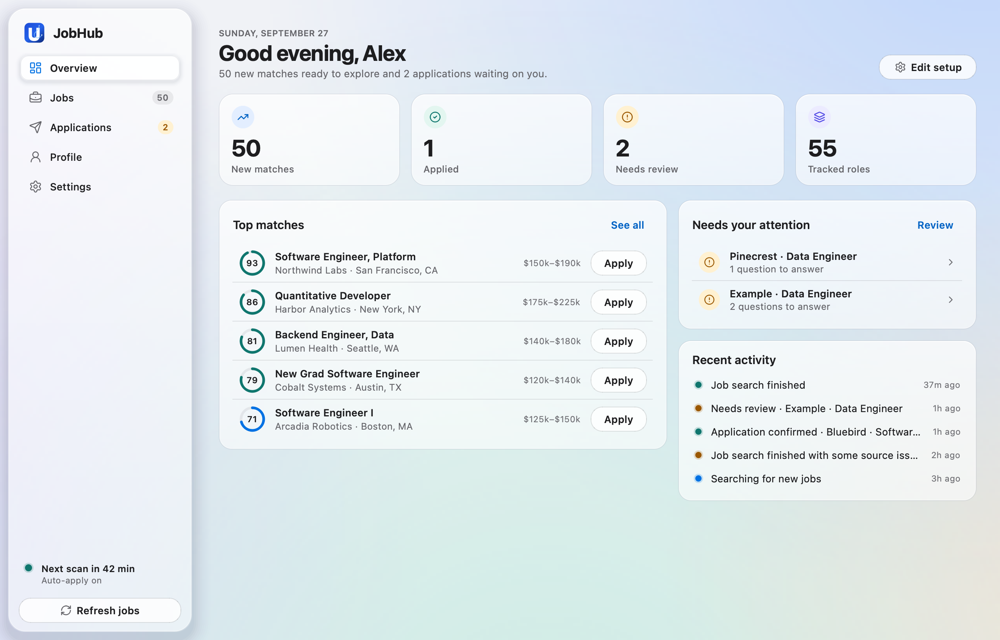

# JobHub

JobHub is a local desktop job-search workspace. The native PySide6 app imports a resume, stores candidate-owned answers, discovers and ranks configured listings, prepares an evidence-based resume PDF, and fills supported employer forms. It includes an hourly scan loop while the desktop app is open.

The native desktop app is the primary interface. The older FastAPI web UI remains available for compatibility and developer workflows, but it is not the main product entrypoint.



The interface follows Apple's current design direction: a floating glass sidebar that holds the macOS window controls, translucent content cards over a soft ambient backdrop, capsule controls, and quick, springy motion that respects Reduce Motion. See it in [dark](docs/screenshots/jobhub-macos-dark.png), the [Jobs table](docs/screenshots/jobhub-jobs-light.png) ([dark](docs/screenshots/jobhub-jobs-dark.png)), [Applications](docs/screenshots/jobhub-applications-light.png) ([dark](docs/screenshots/jobhub-applications-dark.png)), [Settings](docs/screenshots/jobhub-settings-light.png) ([dark](docs/screenshots/jobhub-settings-dark.png)), and the setup wizard ([resume step](docs/screenshots/jobhub-setup-dark.png), [targeting step](docs/screenshots/jobhub-setup-light.png)). These previews use synthetic example records; regenerate them with `uv run python scripts/render_screenshots.py --docs`.

[Product map and prioritized roadmap](docs/ROADMAP.md). Contributors and coding agents should start with [AGENTS.md](AGENTS.md).

## Start the desktop app

On macOS, double-click `Launch JobHub.command` or the built `dist/JobHub.app`. To edit candidate data directly, double-click `Set up JobHub.command`. From a terminal, run:

```sh
./run_desktop.sh
```

The repository launcher uses its `.venv` first, then a packaged build if no local environment exists. A packaged app opened directly uses its own per-user data directory. After a successful checkout import, the source launcher also uses that directory so the two entrypoints share one history. On Windows, use `run_desktop.bat` or `run_setup.bat`. Linux can use `./run_desktop.sh` or `./run_setup.sh`. The source launchers require Python 3.12 and installable project dependencies.

When a packaged build is opened from this checkout's `dist/` folder for the first time, JobHub transfers the existing local database, resume PDFs, tailored PDFs, and application screenshots into its per-user data directory. It backs up any partial destination database and does not replace an existing candidate identity or job history. Browser cookies and `.env` secrets stay in the checkout. A bundle copied elsewhere starts with its own setup wizard.

For a fresh checkout, install [uv](https://docs.astral.sh/uv/getting-started/installation/) and run:

```sh
uv sync --frozen
uv run playwright install chromium
./run_desktop.sh
```

If the checkout already has `.venv`, the launcher uses its Python interpreter. Internet access is needed for dependency and Chromium installation, and for live source scans and employer forms.

## First-run setup

The first launch opens the setup wizard. Drop a resume PDF onto the first step or choose one, review the parsed profile, and correct any extracted fields. Enter the actual facts that an employer may ask for, including current city and country, work authorization, sponsorship, availability, relocation preference, and any other facts you want available to the form engine. Unknown facts remain blank and block an application that requires them.

Set target titles, locations, salary preference, experience, and JobSpy search terms and country. When JobSpy location is blank, each hourly scan searches a bounded rotating batch of your saved title and location combinations, so a long list does not create an unbounded scrape. An explicit JobSpy location overrides that rotation. The scan interval is in Settings and defaults to 60 minutes. You can also enable automatic applications, but it is off by default. Finish setup only after reviewing the saved values.

The answer bank accepts built-in fields and arbitrary question and answer pairs. It has separate fields for US work authorization, sponsorship, and the combined US citizen-or-permanent-resident category; the combined answer does not imply citizenship specifically. Enter one custom pair per line in the form `Question | answer`. Use `true` or `false` for a checkbox that you explicitly want answered, and `\n` within a longer answer. You can supply an existing local file path for an employer-specific upload. The engine reuses a saved answer only when the rendered question matches without ambiguity. Required unknowns stay in **Needs your attention**, and saving new facts requeues only attempts that stopped before Submit. Do not enter an answer that is only an assumption.

To answer a question JobHub encountered, select its row in **Applications** and choose **Answer questions**. The setup wizard opens at the answer bank with those questions ready to fill. Blank suggestions are ignored when saved. The selected application also shows its submission evidence, an editable private note, and the exact resume PDF used.

## Daily workflow

Use **Refresh jobs** for an immediate scan. With the desktop app open and setup complete, the background cycle scans at the configured interval, then considers eligible jobs for the automatic application batch. The app window must remain open, and the computer must remain awake. After a computer wakes from sleep, JobHub starts one fresh cycle rather than replaying every missed hour. Closing the app stops the scheduler.

Automatic application is gated by the saved toggle, completed setup, the minimum match score, supported ATS, required candidate facts, and the per-run application limit. The default limit is three applications per cycle, with at most one attempt per employer in each cycle so a single company's similar forms do not occupy every slot. Dry-run mode fills forms without clicking Submit. Missing answers, unsupported controls, login requirements, CAPTCHAs, and uncertain submit results stop that application for review. A successful application requires a new employer confirmation signal and a durable local application record. A form fill or a Submit click by itself is not treated as success.

Before opening a Greenhouse form, JobHub checks that posting's public required-question metadata against your saved facts. It skips a form with a definitely unanswered required question and considers the next matching job. The live form still makes the final decision because public metadata can omit conditional questions. API failures do not silently reject a job.

Postings more than 180 days old and roles naming a doctorate absent from the candidate profile remain visible for review but are excluded from automatic applications.
Clear IT support and help desk specialties also stay available for review unless your target titles explicitly include the matching specialty.

**Overview** greets you with new matches, applications, review items, and tracked roles; each tile opens the matching list. It also shows your top matches, applications waiting on answers, and recent activity. The sidebar shows when the next scan runs and whether automatic applications are on. The **Jobs**, **Applications**, **Profile**, and **Settings** views expose local state, pending questions, application status, and saved preferences. Recent activity summarizes source issues, while exact source diagnostics remain in the local scan log. Jobs uses database search and 100-row pages, so searches include the entire indexed catalog. Filter with the segmented control, double-click or press Return to open a posting, and right-click a row to skip it, restore it, or copy its link. In Applications, select an attempt to inspect its result, required questions, activity, and resume. Private notes save automatically and never change the employer submission status. Use **Add posting** in Jobs (⌘N) for a direct Greenhouse, Lever, or Ashby URL when discovery misses a listing; the sheet validates the link before importing. Profile and Settings enable **Save** only when something changed, and a background refresh never overwrites unsaved edits.

In **Settings → Appearance**, choose **Automatic**, **Light**, or **Dark**. The change applies immediately with a short crossfade, and Automatic follows the operating system. Progress and results appear as brief notices at the bottom of the window. Keyboard shortcuts: ⌘1–⌘5 switch pages, ⌘R refreshes jobs, ⌘F searches jobs, ⌘S saves the current page, and ⌘, opens Settings. Animations follow the macOS Reduce Motion setting; set `JOBHUB_REDUCED_MOTION=1` to turn them off everywhere, or `JOBHUB_NATIVE_TITLEBAR=0` to keep a standard macOS title bar.

**Settings → Email verification** can optionally finish a Greenhouse email-code challenge. Enter your mail provider's IMAP server, login email, the exact sender address shown on the verification email, and an app password. JobHub stores the password in the operating system credential vault, never in its settings database. This feature is off by default. It checks only fresh messages after Submit and stops for review if the message or code is ambiguous, the mailbox is unavailable, or employer confirmation is missing. Configure it only for a mailbox you own and want JobHub to access. This path has local fixture tests but has not been confirmed unattended against a live employer yet.

## Data and privacy

Source checkouts store data under `data/` by default. The directory contains the SQLite database, resume PDFs, tailored PDFs, screenshots, logs, and the Playwright browser profile. It is ignored by Git and must not be included in a shared source archive. Set `JOBHUB_DATA_DIR` to a dedicated writable directory when the checkout is read-only or when you want another storage location. JobHub rejects a home, filesystem-root, symlink, or unrecognized populated directory as its data root.

Packaged applications use an OS-specific per-user data directory by default: `~/Library/Application Support/JobHub` on macOS, `%LOCALAPPDATA%\\JobHub` on Windows, and `$XDG_DATA_HOME/jobhub` or `~/.local/share/jobhub` on Linux. On macOS and Linux, JobHub creates and repairs that directory and its artifacts with owner-only permissions; it stops if it cannot secure them. Windows uses the account's per-user directory and inherited ACLs. The bundle does not contain a user's resume, database, browser profile, or screenshots. Treat the browser profile and `.env` as sensitive. The core workflow can run with `JOBHUB_LLM_BACKEND=none`; optional model-assisted parsing is explicitly configured and should be reviewed before use.

## Supported behavior and limits

| Area | Current behavior |
| --- | --- |
| Discovery | Public Greenhouse, Lever, and Ashby company feeds, Simplify's new-grad list, RemoteOK, and configured JobSpy searches. |
| Coverage | Configured sources, companies, and search terms only. This is not an index of the entire internet. Rate limits, removed boards, and unavailable feeds are reported. |
| Ranking | Explainable title, skill, experience, location, compensation, freshness, and form-support factors. Scores are ranking heuristics, not hiring probabilities. |
| Resume | Builds a role-specific PDF from saved profile facts. It selects and orders relevant summary sentences, skills, experience, and original bullets without inventing qualifications or numeric claims; a sparse profile falls back to the original PDF. |
| Forms | Browser adapters support ordinary inputs, choices, uploads, and confirmation checks for Greenhouse, Lever, and Ashby. Greenhouse email-code steps have an opt-in IMAP path; other custom flows are flagged for review. |
| Other platforms | Listings can be discovered and opened. Workday, LinkedIn Easy Apply, login flows, and challenge solving are not supported submission paths. |
| Personal answers | Uses resume facts and explicitly saved answers. Required unknowns stop the attempt. It does not guess personal facts or bypass a challenge. |
| Persistence | SQLite stores jobs, settings, source runs, application attempts, and local evidence. Interrupted attempts return to review after restart. |

For every application, rely on both a new employer confirmation and the local application record before counting a submission. A local development log may be kept separately from the source distribution.

## Packaging

The repository includes a PyInstaller recipe in `packaging/`. Build on the target operating system with Python 3.12:

```sh
uv sync --locked --group dev
uv run --no-sync python packaging/build_desktop.py
uv run --no-sync python packaging/smoke_bundle.py
```

On Linux, install Chromium's system libraries first with `uv run --no-sync python -m playwright install-deps chromium`. The build helper installs Chromium into `packaging/playwright-browsers` and embeds it in the bundle. The smoke command checks that the frozen JobSpy native dependency loads, its bundled Chromium launches, and an isolated offscreen Qt window renders. It uses a temporary data directory, never the candidate profile. Expected output is `dist/JobHub.app` on macOS and `dist/JobHub/JobHub.exe` on Windows or `dist/JobHub/JobHub` on Linux. PyInstaller does not cross-compile, so each target needs its own native build and smoke test.

The manual [native bundle workflow](.github/workflows/native-bundles.yml) builds macOS Apple Silicon, macOS Intel, Windows x64, and Linux x64 separately and uploads archives after their tests and smoke checks pass. The macOS signature is ad hoc; these builds are not notarized or Windows code signed. Windows and Linux binaries have not been produced or runtime-verified in this checkout.

For a portable source package to build on another computer, run `uv run python packaging/export_source.py`. It creates `dist/JobHub-source.zip` from an explicit source allowlist. Candidate databases, resumes, local screenshots, browser profiles, `.env`, build caches, and this checkout's personal verification log stay outside the archive. A new user gets the first-run setup wizard.

## Developer commands

```sh
uv run jobhub doctor
uv run jobhub serve --no-scheduler  # legacy web UI for compatibility
uv run jobhub scan
uv run jobhub apply JOB_ID --dry-run
uv run jobhub auto
uv run python -m jobhub.desktop --no-scheduler
uv run pytest -q
uv run python scripts/render_screenshots.py   # every view, light and dark, synthetic data
```

The test suite uses temporary databases and local browser fixtures. It does not submit applications to employers. The legacy web server can be started with `./run.sh`; it is retained for compatibility and is not required for the native desktop app.

## Code map

- `jobhub/desktop/`: native PySide6 app. `ui.py` is the window shell, `views/` holds one module per page, `wizard.py` the setup flow, `widgets.py` and `delegates.py` the glass design system, `theme.py` the design tokens, and `controller.py` the bridge to storage and the scheduler. [AGENTS.md](AGENTS.md) documents the design rules.
- `jobhub/sources/`: public source adapters and direct posting import.
- `jobhub/scoring.py`: deterministic ranking and automatic-application eligibility.
- `jobhub/profile.py`, `answers.py`, `tailor.py`: profile parsing, candidate-owned answers, and PDF output.
- `jobhub/apply/`: ATS adapters, browser form handling, and submission verification.
- `jobhub/db.py`, `scheduler.py`: durable storage and hourly scan/application pipeline.
- `packaging/`: PyInstaller spec, runtime hook, and native build helper.
- `web/`: legacy compatibility interface without a frontend build step.

## References

[JobSpy](https://github.com/speedyapply/JobSpy) supplies board scraping without LLM calls. [Simplify's New Grad Positions](https://github.com/SimplifyJobs/New-Grad-Positions) supplies curated listings. [Lever's postings API](https://github.com/lever/postings-api) documents public discovery endpoints. Public Greenhouse and Ashby feeds supply employer listings directly.
